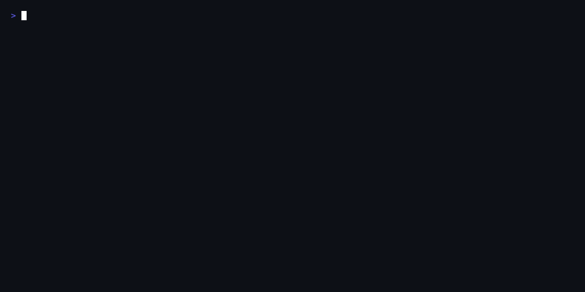
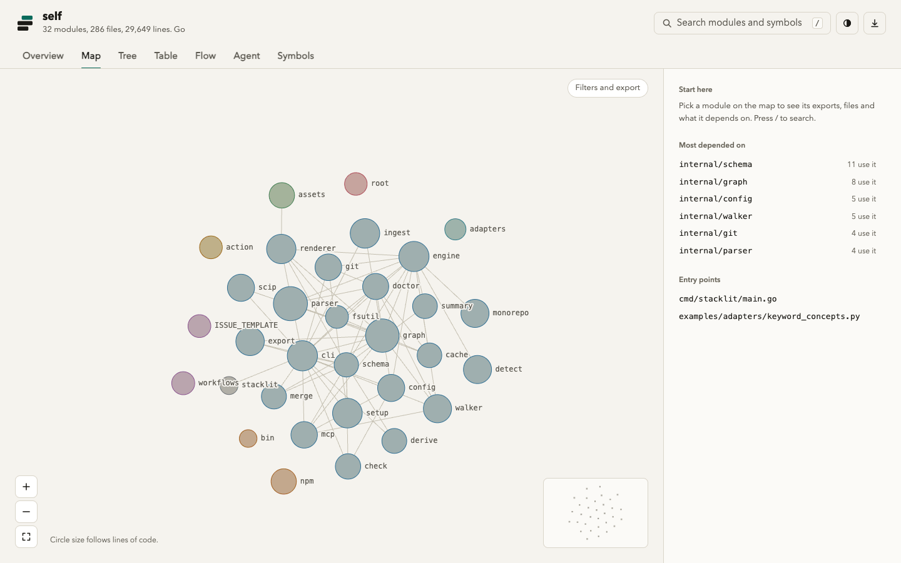
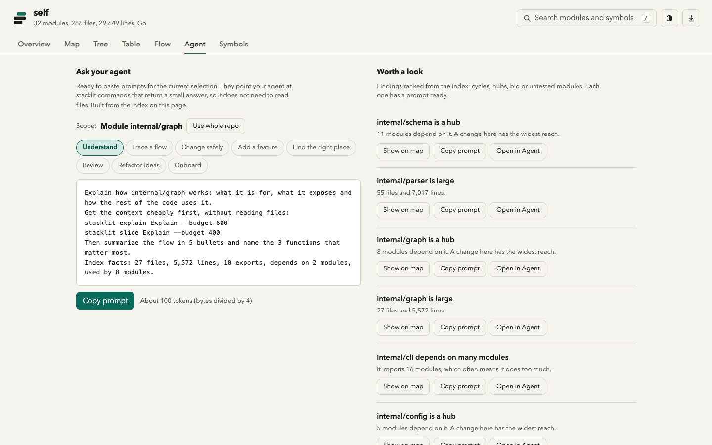
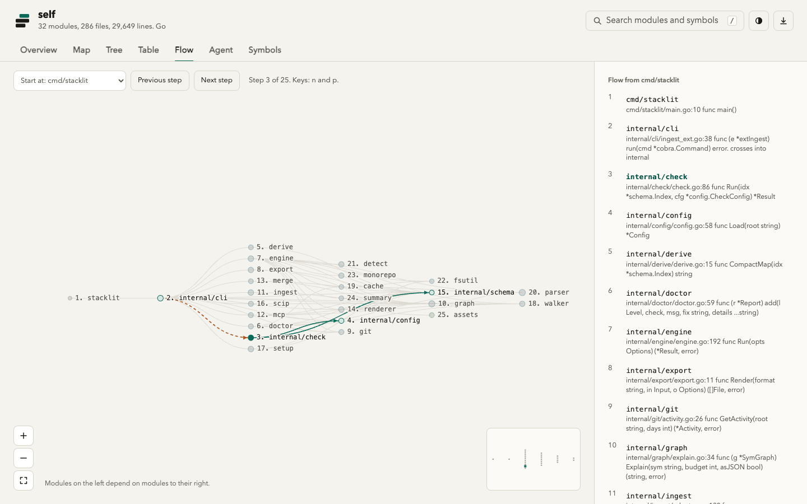

<p align="center">
  <picture>
    <source media="(prefers-color-scheme: dark)" srcset="docs/brand/stacklit-logo-dark.svg">
    
  </picture>
</p>

<p align="center"><b>A committed map of your codebase, built for AI coding agents.</b></p>

<p align="center">
  <a href="https://github.com/glincker/stacklit/actions/workflows/ci.yml"></a>
  <a href="https://github.com/glincker/stacklit/releases"></a>
  <a href="https://www.npmjs.com/package/stacklit"></a>
  <a href="https://www.npmjs.com/package/stacklit"></a>
  <a href="https://pkg.go.dev/github.com/glincker/stacklit"></a>
  <a href="LICENSE"></a>
</p>

<p align="center">
  
</p>

Stacklit parses your repo with tree-sitter and writes `stacklit.json`: modules, exports, dependency edges and hints. Commit it, and an agent reads a few hundred tokens instead of rediscovering the layout every session.
Free and MIT, no paid tier. One Go binary, local and deterministic, no LLM, and the CLI makes no network calls. (The map page can load language icons from thesvg.org; `STACKLIT_MAP_ICONS=off` removes that.)

## Install

```bash
npx stacklit init                                   # scan, write the index, open the map
stacklit setup                                      # wire up the assistants it detects
git add stacklit.json && git commit -m "add stacklit index"
```

Also: `brew install glincker/tap/stacklit`, `npm install -g stacklit`, `go install github.com/glincker/stacklit/cmd/stacklit@latest`, or a binary from [Releases](https://github.com/glincker/stacklit/releases).

## See it

<p align="center">
  <a href="docs/assets/map-overview.png"></a>
  <a href="docs/assets/agent-prompts.png"></a>
  <a href="docs/assets/flow-steps.png"></a>
</p>

## Output

`stacklit derive` prints a compact map for a prompt (gin v1.10.0, 137 tokens, module list trimmed here):

```
gin | go | 8 modules | 19,537 lines | Gin, GitHub Actions, net/http
test: go test ./... | env: PORT

modules:
  binding             binding | depends: bytesconv, json
  internal/bytesconv  bytesconv | depended-by: binding, render, root
  render              render | depends: bytesconv, json
  root                root package | depends: binding, bytesconv, json, render
do-not-touch: .github/
```

`stacklit query` returns a token-budgeted slice of the symbol graph (output trimmed here):

```
$ stacklit query "how is the symbol graph built" --budget 600
internal/cli/graphcmds.go
  50-63 func buildSymbolGraph(root string, includeTests ...bool) (*graph.SymGraph, error)
      calls BuildSymbols E0.95
internal/graph/resolve.go
  955-961 func BuildSymbols(root string, files []string, eo ExtractOptions) *SymGraph
```

## What you get

| | |
|---|---|
| Index | `stacklit.json`, a Mermaid diagram (`DEPENDENCIES.md` by default, set with `output.mermaid`) and an interactive `stacklit.html` map |
| Languages | 48 languages and formats indexed; symbol graph for 20 ([list](docs/LANGUAGES.md)) |
| Queries | `query`, `explain`, `impact`, `path`, `hubs`, `slice`, each with a hard `--budget` |
| MCP | `stacklit serve`: 15 tools, or `--profile minimal` for 4 (about 230 tokens of schema) |
| Hooks | git post-commit refresh; optional Claude Code hook that points a grepped identifier to its definition |
| CI | `export` (graphml, cypher, dot, mermaid and more), `check` architecture rules, `status` freshness, `merge-graphs`, a [GitHub Action](https://github.com/glincker/stacklit-action) |
| Deterministic | same repo, same bytes. A committed index only changes when the code does |
| Privacy | no telemetry, no upload. The map loads language logos from thesvg.org unless `STACKLIT_MAP_ICONS=off` ([details](docs/PRIVACY.md)) |

## Assistants

<p align="center">
  <a href="https://claude.com/claude-code"></a>&nbsp;
  <picture><source media="(prefers-color-scheme: dark)" srcset="https://thesvg.org/icons/cursor/dark.svg"></picture>&nbsp;
  <picture><source media="(prefers-color-scheme: dark)" srcset="https://thesvg.org/icons/codex/dark.svg"></picture>&nbsp;
  &nbsp;
  <picture><source media="(prefers-color-scheme: dark)" srcset="https://thesvg.org/icons/github-copilot/dark.svg"></picture>&nbsp;
  <picture><source media="(prefers-color-scheme: dark)" srcset="https://thesvg.org/icons/windsurf/dark.svg"></picture>&nbsp;
  <picture><source media="(prefers-color-scheme: dark)" srcset="https://thesvg.org/icons/zed/dark.svg"></picture>&nbsp;
  
</p>

`stacklit setup --list` shows all 26 targets, including Aider, Cline, Continue, OpenCode, Roo Code, Kiro and a generic `AGENTS.md`. Anything else can read `stacklit.json` directly.

## Benchmark

Three pinned repos, 30 navigation tasks, no model calls, tokens as bytes / 4. The index is 2,524 to 16,126 tokens and the derived map 137 to 1,372. This does **not** show a token saving over grep: when the exact symbol is known, grep is cheaper, and the grep and read baseline found the answer on 30 of 30 tasks against 27 for the map path. What it shows is cheap orientation. Method, misses and limits: [bench/RESULTS.md](bench/RESULTS.md).

## Docs

[Usage](docs/USAGE.md) | [Languages](docs/LANGUAGES.md) | [FAQ](docs/FAQ.md) | [Privacy](docs/PRIVACY.md) | [Architecture](docs/ARCHITECTURE.md) | [Comparison](docs/COMPARISON.md) | [Roadmap](docs/ROADMAP.md) | [Changelog](CHANGELOG.md) | [Agent skill](skills/stacklit/SKILL.md) | [Brand kit](docs/brand/README.md)

Contributing: [.github/CONTRIBUTING.md](.github/CONTRIBUTING.md). Security reports: [.github/SECURITY.md](.github/SECURITY.md). Questions: [Discussions](https://github.com/glincker/stacklit/discussions).

MIT. See [LICENSE](LICENSE).
