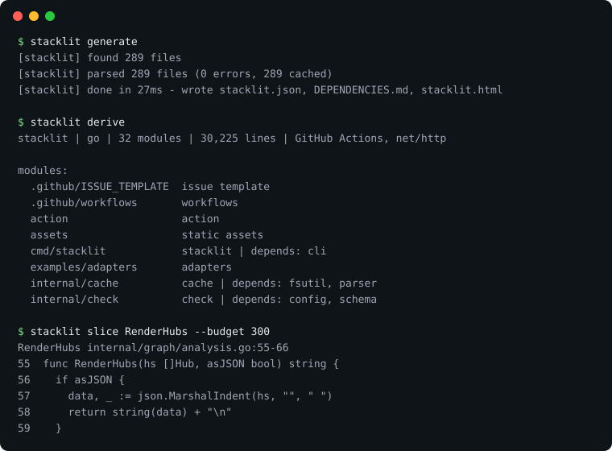

<h1 align="center">Stacklit</h1>

<p align="center"><b>A small, committed map of your codebase, so AI coding agents stop re-exploring it every session.</b></p>

<p align="center">
  <a href="https://github.com/glincker/stacklit/actions"></a>
  <a href="https://github.com/glincker/stacklit/releases"></a>
  <a href="https://www.npmjs.com/package/stacklit"></a>
  <a href="https://www.npmjs.com/package/stacklit"></a>
  <a href="LICENSE"></a>
  <a href="https://github.com/glincker/stacklit/stargazers"></a>
</p>

<p align="center"></p>

Stacklit parses your repo with tree-sitter and writes `stacklit.json`: modules, what each exports, who depends on whom, and hints for running tests and adding features. A compact view of it, `stacklit derive`, is a map an agent can read in a few hundred tokens. The index is plain JSON, so you commit it and every clone, CI job and teammate gets the same map.

Free and MIT. No paid tier, no account, no telemetry, no LLM needed to build the index. One Go binary.

## Why

- **Cheap orientation.** On the three benchmark repos the derived map is 137 to 1,372 tokens and the full index is 2.5k to 16k tokens. It grows with the number of modules, not with lines of code.
- **Agent steering.** Hard token budgets on every query (`--budget`), an MCP server, and short guidance injected into each assistant's config tell the agent where to look first.
- **Deterministic.** Same repo, same bytes out. Prompt caches stay warm and the index diffs cleanly in review.
- **Local only.** Nothing is uploaded. See [Privacy](#privacy).

It is not a search engine and it does not claim to beat grep. When you know the exact identifier, grep is cheaper. See [Benchmarks](#benchmarks) for what was measured.

## Quick start

```bash
npx stacklit init          # downloads the binary, indexes the repo, opens the visual map
stacklit setup             # wires up the AI tools it finds, installs a git hook
git add stacklit.json DEPENDENCIES.md && git commit -m "add stacklit index"
```

Other installs:

```bash
brew install glincker/tap/stacklit
npm install -g stacklit
go install github.com/glincker/stacklit/cmd/stacklit@latest
```

Binaries for macOS, Linux and Windows are on [Releases](https://github.com/glincker/stacklit/releases). The 48-language index, symbol graph commands and 26-assistant setup described below are on `master` and ship in 0.5.0; until then use `go install github.com/glincker/stacklit/cmd/stacklit@master` to get them.

## What you get

| Output | What it is | Commit it? |
|--------|-----------|------------|
| `stacklit.json` | The index agents read: modules, exports, dependency edges, hints | Yes |
| `DEPENDENCIES.md` | Mermaid dependency diagram, renders on GitHub | Yes |
| `stacklit.html` | Self-contained interactive map (graph, tree, table, flow) | No, gitignored |
| `stacklit derive` | Compact text map for a prompt, printed to stdout | No, generated on demand |
| `stacklit.graph.json` | Symbol graph for `query`, `impact`, `explain`, `slice`, `path`, `hubs` | Optional |
| MCP server | `stacklit serve`, 15 tools over the index and the symbol graph | n/a |

## See it work

Run on this repository (289 files, 30,225 lines of Go). The index is about 9.7k tokens; the map below is about 600.

```
$ stacklit derive
stacklit | go | 32 modules | 30,225 lines | GitHub Actions, net/http

modules:
  cmd/stacklit            stacklit | depends: cli
  internal/cache          cache | depends: fsutil, parser
  internal/check          check | depends: config, schema
  internal/fsutil         fsutil | depended-by: cache, engine, renderer
  ...
```

Ask a question under a hard token limit:

```
$ stacklit query "how are MCP tools registered" --budget 600
internal/mcp/graph_tools.go
  72-118 func registerGraphTools(s *sdkmcp.Server)
internal/mcp/server.go
  67-236 func StartServer() error  // creates and runs the MCP server over stdio
...
```

See the blast radius of a change, or read one symbol instead of a whole file:

```
$ stacklit impact RenderHubs
6 dependents (2 direct) across 5 files, depth<=4
$ stacklit slice RenderHubs --budget 300     # prints lines 55-66 of internal/graph/analysis.go
```

## Works with

`stacklit setup` detects the assistants in use, injects a 300 to 500 token digest between `<!-- stacklit:start -->` markers, registers the MCP server where the tool supports project config, and installs a post-commit hook. Nothing outside the repo is written unless you pass `--global`.

Claude Code, Cursor, Aider, Codex, Gemini CLI, GitHub Copilot, Windsurf, Cline, Zed, Continue, OpenCode, Amp, Roo Code, Kilo Code, Junie, JetBrains AI, Augment, Trae, Kiro, Goose, Warp, Crush, Qwen Code, Factory Droid, Replit, and a generic `AGENTS.md`. That is 26 targets; `stacklit setup --list` shows them and marks the ones it detects.

```bash
stacklit setup claude codex      # specific tools
stacklit setup --all --dry-run   # preview, prints digest size
stacklit setup --all --uninstall # reverse everything
```

Any other MCP client can run `stacklit serve` over stdio. Anything else can read `stacklit.json` directly, or use [SKILL.md](SKILL.md).

## Languages

48 languages and formats go into the index (imports, exports, types, dependency edges), including Go, TypeScript, JavaScript, Python, Rust, Java, C#, Ruby, PHP, Kotlin, Swift, C, C++, Scala, Elixir, Dart, Zig, Haskell, SQL, Terraform, Protobuf and more. The symbol graph (`query`, `impact`, `slice`) covers Go, TypeScript and JavaScript, Python, Rust and Java today; wider coverage is in progress. Monorepos (pnpm, npm, yarn, Go and Cargo workspaces, Nx, Turborepo, Lerna) are detected automatically. Full table: [docs/LANGUAGES.md](docs/LANGUAGES.md).

## Benchmarks

The harness in [bench/](bench/) is deterministic, makes no LLM calls and pins three public repos by commit. Tokens are bytes divided by 4. Full methodology and limitations: [bench/RESULTS.md](bench/RESULTS.md).

| Repo | Language | Source lines | Modules | `stacklit.json` | `derive` map | Generate (median) |
|------|----------|-------------:|--------:|----------------:|-------------:|------------------:|
| gin v1.10.0 | Go | 19,537 | 8 | 2,524 tokens | 137 tokens | 40 ms |
| flask 3.1.2 | Python | 18,515 | 14 | 2,681 tokens | 221 tokens | 2.3 s |
| hono v4.6.0 | TypeScript | 57,307 | 79 | 16,126 tokens | 1,372 tokens | 0.6 s |

What it does and does not show:

- Orientation is cheap. The map costs a few hundred tokens whatever the repo size.
- It does not show a token saving over grep. When you know the exact symbol, grep is cheaper. In this proxy, grep and read found the answer on 30 of 30 tasks, stacklit map and lookup on 27, and `stacklit query` on 28.
- Weak spots are listed, not hidden: unexported symbols, truncated export lists, imperfect dependency edges, and about 1.6 GB peak memory generating flask cold.
- This is a token-cost proxy, not an agent evaluation. Read the limitations before quoting a number.

## Keeping it fresh

```bash
stacklit generate     # regenerate now
stacklit diff         # is the index stale?
stacklit doctor       # config, hooks, stale index, parse errors
```

The post-commit hook from `stacklit setup` does this on every commit. In CI, [stacklit-action](https://github.com/glincker/stacklit-action) either commits a refreshed index or fails a PR when it is stale.

## Privacy

Stacklit reads your files locally and writes into your repository. No telemetry, no analytics, no account, no upload. The generated HTML map loads nothing from the network. The one opt-in exception is `stacklit init --summary`, which pipes an index snapshot (names only, no file contents) to a command you control. Details: [docs/PRIVACY.md](docs/PRIVACY.md).

## Docs

- [USAGE.md](USAGE.md): every command, MCP tool, config option and the index schema
- [docs/FAQ.md](docs/FAQ.md), [docs/LANGUAGES.md](docs/LANGUAGES.md), [docs/PRIVACY.md](docs/PRIVACY.md), [docs/ARCHITECTURE.md](docs/ARCHITECTURE.md)
- [bench/RESULTS.md](bench/RESULTS.md): benchmark methodology and results
- [COMPARISON.md](COMPARISON.md), [ROADMAP.md](ROADMAP.md), [CHANGELOG.md](CHANGELOG.md), [SKILL.md](SKILL.md)

## Contributing

```bash
make build && make test
```

Bug reports, parser fixes and new language extractors are welcome. See [CONTRIBUTING.md](CONTRIBUTING.md) and [SECURITY.md](SECURITY.md). Questions and ideas go in [Discussions](https://github.com/glincker/stacklit/discussions).

## License

MIT. See [LICENSE](LICENSE).
